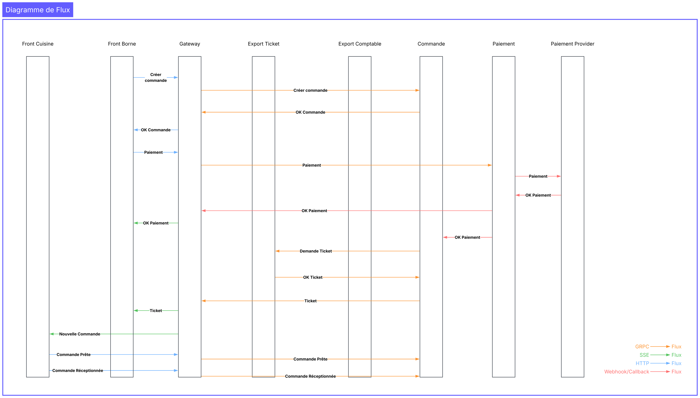
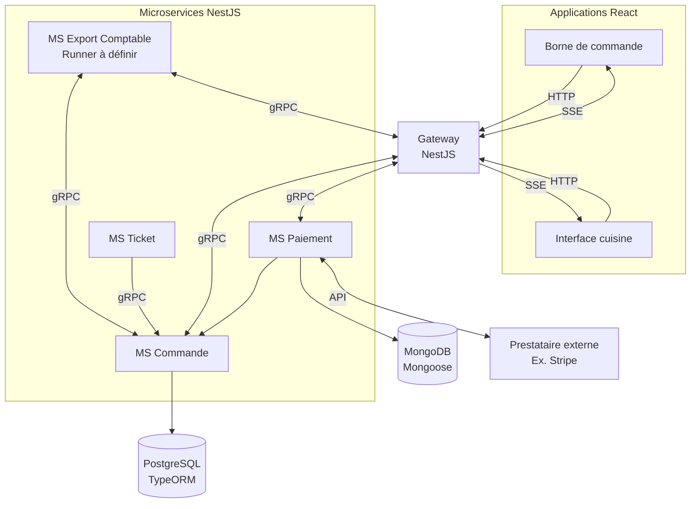

#  Makido

Développé par [__ARCAS__ Manon](https://github.com/Manon-Arc), [__BARBOTEAU__ Mathieu](https://github.com/Kilecon), [__MACE__ Léo](https://github.com/LeoMa33) et [__DE AMEZAGA__ Bastien](https://github.com/Bastien-DA),

**Kit complet de gestion de commandes pour la restauration rapide**

## ❓ Contexte

Le projet Makido a pour objectif de mettre en place un kit complet de gestion de commandes pour un restaurant de restauration rapide.

Il propose un écosystème permettant de gérer l'ensemble du cycle de vie d'une commande, depuis sa création sur une borne interactive jusqu'à sa préparation en cuisine, en passant par son paiement et la génération du ticket de caisse.

## 🔧 Description

Makido repose sur deux interfaces principales :

- **Borne de commande** : permet aux clients de consulter le catalogue de produits, de composer leur commande et de procéder au paiement.
- **Interface cuisine** : permet au personnel de visualiser les commandes en attente, de suivre leur ancienneté et de consulter les informations nécessaires à leur préparation.

Le système s'appuie sur une architecture backend distribuée en microservices NestJS. Chaque service possède une responsabilité métier distincte et communique avec les autres via gRPC.

## 📌 Sommaire

- [🚀 Écosystème](#-écosystème)
- [🔧 Architecture](#-architecture)
- [🏗️ Infrastructure](#️-infrastructure)
- [📂 Arborescence](#-arborescence)
- [📥 Installation](#-installation)
- [🚀 Lancement](#-lancement)
- [🗄️ Base de données](#️-base-de-données)
- [🔁 CI / CD](#-ci--cd)
- [🛡️ Sécurité & Contexte](#️-sécurité--contexte)
- [🔌 Dépendances](#-dépendances)

---

## 🚀 Écosystème

Makido est composé de plusieurs briques fonctionnant en synergie pour assurer l'ensemble du cycle de vie d'une commande.

### Applications Frontend

| Composant | Stack technique | Responsabilité |
| :--- | :--- | :--- |
| **Borne de commande** |  | Consultation du catalogue, composition et validation des commandes. |
| **Interface cuisine** |  | Affichage des commandes en temps réel et suivi de leur ancienneté. |

### Backend & Microservices

Le backend repose sur NestJS et une architecture orientée microservices.

| Composant | Stack technique | Responsabilité |
| :--- | :--- | :--- |
| **Gateway** |  | Point d'entrée unique. Conversion des requêtes HTTP du frontend en appels gRPC. |
| **MS Commande** |   | Gestion du cycle de vie des commandes et persistance des données. |
| **MS Paiement** |   | Initialisation des transactions auprès de prestataires externes, enregistrement des informations et suivi des statuts. |
| **MS Ticket** |  | Génération des tickets de caisse à partir des commandes validées et payées. |
| **MS Export Comptable** |  | Récupération des données de commande et génération des exports comptables et historiques. |

### 📌 Fonctionnalités

#### Borne de commande

- [ ] Consultation du catalogue de burgers et des articles disponibles.
- [ ] Ajout et suppression d'articles dans une commande.
- [ ] Visualisation du récapitulatif de commande.
- [ ] Validation de la commande.
- [ ] Initialisation et validation du paiement.
- [ ] Génération et récupération du ticket de caisse après validation du paiement.

#### Interface cuisine

- [ ] Affichage de la file des commandes à préparer.
- [ ] Visualisation de l'ancienneté de chaque commande.
- [ ] Actualisation des commandes en temps réel via SSE.
- [ ] Suivi de l'état des commandes.
- [ ] Export de l'historique des commandes de la journée.
- [ ] Génération de statistiques sur les temps de préparation au format `.xlsx`.

#### Services backend

- [ ] Centralisation des requêtes HTTP via la Gateway.
- [ ] Communication interservices via gRPC.
- [ ] Gestion du cycle de vie des commandes.
- [ ] Gestion des transactions et des statuts de paiement.
- [ ] Génération automatique des tickets de caisse.
- [ ] Export des données comptables.
- [ ] Exécution des exports historiques via le MS Export Comptable.

---

## 🔧 Architecture

Makido adopte une architecture **Monorepo** regroupant les applications frontend, les microservices backend et les packages partagés au sein d'un même dépôt.

Le backend repose sur NestJS et une architecture distribuée en microservices. Chaque service possède une responsabilité métier distincte et communique avec les autres via gRPC.

### 🌐 Communication

Le système repose sur trois modes de communication :

| Protocole | Utilisation |
| :--- | :--- |
| **HTTP** | Communication entre les applications React et la Gateway. |
| **gRPC** | Communication interservices entre les différents microservices NestJS. |
| **SSE (Server-Sent Events)** | Transmission des mises à jour en temps réel vers l'interface cuisine. |

La Gateway constitue le seul point d'entrée HTTP du backend. Elle assure la conversion des requêtes frontend en appels gRPC.

L'interface cuisine utilise SSE pour recevoir les évolutions de la file de commandes sans avoir à effectuer de requêtes répétées.




### 🧩 Organisation des services

| Service | Responsabilité | Technologie |
| :--- | :--- | :--- |
| **Gateway** | Point d'entrée HTTP et routage des requêtes vers les microservices. | NestJS / gRPC |
| **MS Commande** | Gestion du cycle de vie des commandes et de leur persistance. | NestJS / TypeORM |
| **MS Paiement** | Initialisation des transactions, enregistrement des informations et suivi des statuts. | NestJS / Mongoose |
| **MS Ticket** | Génération des tickets de caisse à partir des commandes validées et payées. | NestJS |
| **MS Export Comptable** | Récupération des données de commande et génération des exports comptables et historiques. | NestJS |

### 🔄 Flux de communication

**1. Création et validation d'une commande**

- Le client sélectionne ses articles depuis la borne.
- La requête HTTP est transmise à la Gateway.
- La Gateway communique avec le MS Commande via gRPC.
- Le MS Commande enregistre la commande dans PostgreSQL.

**2. Paiement**

- Une demande de paiement est transmise au MS Paiement.
- Le service initialise une transaction auprès d'un prestataire externe (ex. Stripe).
- Les informations de transaction sont enregistrées dans MongoDB via Mongoose.
- Le statut du paiement est retourné au système.

**3. Génération du ticket**

- Une fois la commande validée et payée, le MS Ticket intervient.
- Le MS Commande lui transmet la commande et ses ingrédients via gRPC.
- Le ticket de caisse est généré et mis à disposition du système.

**4. Préparation en cuisine**

- L'interface cuisine reçoit les commandes à préparer.
- Les commandes sont affichées avec leur ancienneté.
- Le MS Commande fournit les évolutions nécessaires à la Gateway.
- La Gateway transmet les mises à jour à l'interface cuisine via SSE.

**5. Export comptable et historique**

- Le MS Export Comptable sollicite le MS Commande via gRPC.
- Les données nécessaires sont récupérées.
- Le service génère les exports comptables.
- Le MS Export Comptable prend également en charge les exports historiques et la génération des statistiques de la journée au format Excel. Le mécanisme précis de déclenchement du Runner reste à définir.

### 📊 Schéma d'architecture



---

## 🏗️ Infrastructure

L'ensemble des composants est regroupé dans un Monorepo afin de faciliter le partage de code, la gestion des dépendances et la maintenance du projet.

| Service | Technologie | Utilisation |
| :--- | :--- | :--- |
| **Base de données commandes** | PostgreSQL | Persistance des commandes. |
| **ORM commandes** | TypeORM | Mapping objet-relationnel et gestion du schéma PostgreSQL. |
| **Base de données paiements** | MongoDB | Persistance des transactions. |
| **ODM paiements** | Mongoose | Mapping objet-document et gestion des données MongoDB. |
| **Communication interne** | gRPC | Échanges entre microservices. |
| **Communication temps réel** | SSE | Diffusion des mises à jour vers la cuisine. |
| **Paiement externe** | Stripe ou équivalent | Traitement des transactions. |

Les différents services pourront être exécutés indépendamment ou orchestrés via Docker Compose.

---

## 📂 Arborescence

Le projet suit une organisation **Monorepo** regroupant les applications, les packages partagés et la documentation.

### Organisation globale

```text
📦 Makido
 ┣ 📂 .github
 ┃ ┗ 📂 workflows                # 🔁 CI / CD
 ┃
 ┣ 📂 apps
 ┃ ┣ 📂 back                      # ⚙️ Backend NestJS
 ┃ ┃ ┣ 📂 gateway              # 🌐 Point d'entrée HTTP
 ┃ ┃ ┣ 📂 ms-commande          # 📋 Gestion des commandes
 ┃ ┃ ┣ 📂 ms-paiement          # 💳 Gestion des paiements
 ┃ ┃ ┣ 📂 ms-ticket            # 🧾 Génération des tickets
 ┃ ┃ ┗ 📂 ms-export-comptable  # 📊 Exports et Runner
 ┃ ┃
 ┃ ┗ 📂 front                    # 🖥️ Application React
 ┃
 ┣ 📂 docs                       # 📚 Documentation
 ┃ ┣ 📜 architecture.md
 ┃ ┗ 📜 ...
 ┃
 ┣ 📂 packages                   # ♻️ Packages partagés
 ┃ ┣ 📂 eslint                   # 🔍 Configuration ESLint
 ┃ ┣ 📂 tsconfig                 # ⚙️ Configuration TypeScript
 ┃ ┣ 📂 schemas                  # 📑 Schémas et contrats partagés
 ┃ ┣ 📂 ui                       # 🎨 Composants UI
 ┃ ┣ 📂 utils                    # 🔧 Fonctions utilitaires
 ┃ ┗ 📂 ...
 ┃
 ┣ 📜 .dockerignore
 ┣ 📜 .gitignore
 ┣ 📜 .npmrc
 ┣ 📜 Dockerfile
 ┣ 📜 docker-compose.yml
 ┗ 📜 package.json
```

*Cette arborescence reprend l'organisation Monorepo envisagée. Les noms et l'emplacement exacts des applications et packages sont à adapter à la structure effective du dépôt.*

### Packages partagés

Le dossier `packages/` permet de centraliser les éléments communs aux différentes applications.

| Package | Responsabilité |
| :--- | :--- |
| `eslint` | Configuration commune des règles de lint. |
| `tsconfig` | Configurations TypeScript partagées. |
| `schemas` | Schémas de validation et contrats de données partagés. |
| `ui` | Composants d'interface réutilisables. |
| `utils` | Fonctions utilitaires communes. |

Cette organisation évite la duplication de code et garantit une cohérence technique entre les applications.

---

## 📥 Installation

### Compatibilité OS

| Statut | Système d'exploitation |
| :---: | :--- |
| ✅ |  |
| ✅ |  |
| ✅ |  |

### Prérequis

| Outil | Utilisation |
| :--- | :--- |
|  | Environnement d'exécution JavaScript |
|  | Gestionnaire de dépendances |
|  | Conteneurisation des services |
|  | Base de données des commandes |
|  | Base de données des paiements |

Les versions utilisées par le monorepo sont déclarées dans `package.json` et `pnpm-workspace.yaml`.

### Configuration (`.env`)

Les variables d'environnement sont à répartir selon les besoins de chaque application et microservice. Les noms ci-dessous constituent une base de configuration à adapter aux fichiers `.env.example` du projet.

| Variable | Description |
| :--- | :--- |
| `DB_HOST` / `DB_PORT` | Hôte et port de PostgreSQL. |
| `DB_USER` / `DB_PASSWORD` | Identifiants PostgreSQL. |
| `DB_NAME` | Nom de la base de données des commandes. |
| `MONGO_URI` | URI de connexion à MongoDB. |
| `GRPC_HOST` / `GRPC_PORT` | Configuration des communications gRPC. |
| `GATEWAY_PORT` | Port d'exposition HTTP de la Gateway. |
| `PAYMENT_PROVIDER` | Prestataire de paiement utilisé. |
| `STRIPE_SECRET_KEY` | Clé secrète du prestataire Stripe, si utilisé. |
| `STRIPE_WEBHOOK_SECRET` | Secret de validation des notifications Stripe, si utilisé. |

> [!IMPORTANT]
> Les clés d'API et les informations de connexion doivent être stockées dans les variables d'environnement et ne doivent jamais être versionnées dans le dépôt Git.

---

## 🚀 Lancement

Le Monorepo regroupe les applications et les microservices au sein d'un même dépôt. L'installation des dépendances s'effectue donc depuis la racine, selon le gestionnaire de packages et les scripts configurés dans le projet.

### Initialisation

```bash
# 1. Cloner le dépôt
git clone <URL_DU_DEPOT>

# 2. Accéder au dossier
cd Makido

# 3. Installer les dépendances
pnpm install
```

### Démarrage local avec Docker Compose

Le Compose racine réutilise la configuration du MS Commande (Docker Compose 2.20 ou supérieur pour `include`). Il publie le service gRPC sur le port `50051`. Les migrations TypeORM doivent être appliquées avant le démarrage du service ; la synchronisation automatique est désactivée.

Les migrations versionnées conservent l'historique du schéma : on ajoute une migration pour chaque évolution, sans modifier les anciennes. Elles sont distinctes des fixtures de données.

Avant le lancement, préparer les fichiers PEM dans `apps/command/certs/` (ou définir `GRPC_CERT_DIR` pour utiliser un autre dossier) :

- `command.crt` et `command.key` : certificat et clé du service, autorisés comme serveur et client TLS ;
- `client-ca.crt` : autorités de certification des clients gRPC autorisés ;
- `payment-ca.crt` : autorité dédiée qui signe directement le certificat client du service Paiement ;
- `server-ca.crt` : autorités des serveurs Paiement et Ticket.

Les certificats des serveurs doivent correspondre à leurs noms DNS. Les clés privées ne doivent pas être versionnées et doivent être lisibles par l'utilisateur `node` du conteneur. Définir `PAYMENT_GRPC_URL` et `TICKET_GRPC_URL` avec les adresses DNS des services correspondants ; les valeurs Compose par défaut sont des exemples, ces services ne sont pas inclus dans le Compose.

```bash
docker compose build ms-command
docker compose up -d postgres
docker compose run --rm --no-deps ms-command node apps/command/dist/migrate.js
docker compose up -d ms-command
```

Une fois le service démarré, charger les données de démonstration manuellement depuis un autre terminal :

```bash
docker compose exec -w /workspace/apps/command ms-command node dist/seed.js
```

Cette commande est réservée au développement. Elle complète les personnalisations et ingrédients vides des articles existants sans écraser les valeurs non vides. Les ingrédients des données de démonstration sont indicatifs et doivent être validés avant un usage réel.

Le mot de passe PostgreSQL par défaut (`local_dev_password`) est réservé au développement local. Pour le remplacer, définissez `DB_PASSWORD` dans un fichier `.env` à la racine avant de lancer Compose. Ne réutilisez jamais cette valeur par défaut en production.

```bash
docker compose down
```

`docker compose down` conserve le volume et les données de la base.

À ce stade, les autres composants décrits dans l'architecture (frontends, gateway, services de paiement/ticket/export, Redis et job-runner) ne sont pas encore inclus dans le Compose exécutable.

> [!IMPORTANT]
> Le port gRPC `50051` est exposé pour les clients locaux. Le mot de passe de développement ne convient pas à un environnement partagé ou de production.

### Flux gRPC de commande

`FinalizeCommand` reçoit une clé d'idempotence, les articles, leurs quantités et personnalisations, et le total en centimes. Le service vérifie le catalogue et le prix, persiste un instantané de la commande, puis demande le paiement. Il retourne uniquement la référence courte à neuf chiffres. Pour les options incluses dans le prix, le client précise `includedQuantity` et le service vérifie les limites du groupe.

La référence complète transmise au paiement est `YYYY-MM-DD-` suivie de la référence courte ; le compteur est journalier en UTC et recommence à `000000001` après `999999999`. Pour distinguer un éventuel bouclage, Paiement doit renvoyer **la référence complète et l'horodatage UTC exact** reçus dans `PaymentConfirmed`. Seul un certificat signé directement par la CA Paiement dédiée peut appeler cette méthode. Le service transmet ensuite au Ticket la date, la référence courte, les ingrédients et les personnalisations enregistrés.

En cas d'échec d'un appel interservice, l'état reste enregistré et une erreur gRPC est renvoyée : l'appelant doit réessayer avec la même clé ou la même confirmation. Une clé de finalisation réutilisée avec un contenu différent est refusée. Les contrats proposés pour Paiement et Ticket imposent une clé d'idempotence ; leurs futures implémentations doivent dédupliquer leurs propres opérations. Les montants sont limités aux entiers représentables exactement par JavaScript.

Les tests d'intégration sont ignorés par défaut. Pour les exécuter, fournir `COMMAND_TEST_DB_PORT` pour une base PostgreSQL **jetable** locale nommée `isolated_test` (utilisateur et mot de passe `isolated_test`), et `COMMAND_TEST_CERT_DIR` pour un dossier de certificats de test. Ces tests écrivent dans la base : ne jamais les pointer vers une base partagée.
Le dossier de test doit contenir trois CA (`server-ca.crt`, `client-ca.crt`, `payment-ca.crt`) et trois paires certificat/clé (`command`, `gateway`, `payer`). Chaque paire est signée respectivement par sa CA ; le certificat serveur `command` doit couvrir `localhost` et être utilisable comme client et serveur.

---

## 🗄️ Base de données

Makido utilise deux systèmes de gestion de bases de données distincts afin de séparer les données métier des commandes et les informations liées aux transactions.

### Communication & ORM / ODM

| Base de données | Technologie | ORM / ODM | Service |
| :--- | :--- | :--- | :--- |
| **PostgreSQL** | Relationnelle | TypeORM | MS Commande |
| **MongoDB** | Documentaire | Mongoose | MS Paiement |

Chaque microservice est responsable de ses propres données et de leur persistance.

### Gestion du schéma

**PostgreSQL — TypeORM**

Le MS Commande utilise TypeORM pour assurer la persistance des données relationnelles.

Il est notamment responsable :

- De la définition des entités.
- De la gestion des relations entre les données.
- De la génération et de l'exécution des migrations.
- De l'accès aux données via les repositories.

**MongoDB — Mongoose**

Le MS Paiement utilise Mongoose pour gérer les documents MongoDB.

Il est notamment responsable :

- De la définition des schémas.
- De la validation des documents.
- De la gestion des modèles.
- De la persistance des transactions et de leurs statuts.

### Exports des données

Les données de commande sont exploitées par le MS Ticket et le MS Export Comptable via gRPC.

Le MS Export Comptable centralise également les traitements d'export historique. Son mécanisme de Runner reste à définir : son mode de déclenchement et sa planification ne sont pas encore arrêtés.

---

## 🔁 CI / CD

Le projet a vocation à intégrer une chaîne d'intégration et de déploiement continu basée sur GitHub Actions.

La séparation en applications et microservices au sein du Monorepo permet d'envisager des pipelines adaptés aux différents composants, tout en conservant une gestion centralisée du dépôt.

### Intégration continue (CI)

Les pipelines d'intégration continue ont pour objectif de vérifier la qualité du code avant son intégration.

Étapes envisagées :

- Récupération du code source.
- Installation des dépendances.
- Vérification du typage et du lint.
- Exécution des tests unitaires.
- Exécution des tests d'intégration.
- Génération des rapports de couverture de tests.

### Déploiement continu (CD)

Les pipelines de déploiement permettent d'automatiser la mise en production des composants.

Étapes envisagées :

- Construction des images Docker.
- Publication des images sur un registre.
- Récupération des nouvelles versions sur le serveur.
- Mise à jour des services.
- Vérification de leur état de fonctionnement.

Les workflows, leur périmètre et leurs déclencheurs seront documentés au fur et à mesure de leur mise en place.

---

## 🛡️ Sécurité & Contexte

La sécurité de Makido repose sur la séparation des responsabilités et le contrôle des communications entre les différents composants.

### Gateway

La Gateway constitue le seul point d'entrée des applications frontend vers le backend.

- Les applications communiquent avec la Gateway via HTTP.
- La Gateway assure la conversion des requêtes vers les protocoles gRPC.
- Les microservices ne sont pas directement exposés aux applications frontend.

### Communication interservices

Les échanges entre microservices utilisent gRPC.

Cette organisation permet de :

- Centraliser les échanges entre les composants.
- Définir des contrats de communication explicites.
- Limiter les dépendances directes entre les applications frontend et les services métiers.

### Communication temps réel

L'interface cuisine reçoit les mises à jour via Server-Sent Events (SSE).

La Gateway assure l'exposition du flux SSE vers le frontend. Les modalités de transmission des événements depuis le MS Commande jusqu'à la Gateway restent à préciser.

### Gestion des paiements

Le MS Paiement est isolé du reste de la logique métier.

- Les transactions sont initialisées auprès d'un prestataire externe.
- Les informations nécessaires sont enregistrées dans MongoDB.
- Le statut du paiement est retourné au système.
- Les informations sensibles du prestataire sont conservées dans des variables d'environnement.

La validation d'une commande et la confirmation de son paiement doivent être traitées comme deux états distincts afin de garantir la cohérence du cycle de vie d'une commande.

---

## 🔌 Dépendances

L'architecture de Makido repose sur plusieurs technologies et composants indépendants.

### Communication

- **NestJS** : framework backend utilisé pour développer les microservices.
- **gRPC** : protocole de communication interservices.
- **SSE** : diffusion des mises à jour de commandes vers l'interface cuisine.
- **React** : framework utilisé pour les interfaces frontend.

### Persistance

- **TypeORM** : ORM utilisé par le MS Commande avec PostgreSQL.
- **Mongoose** : ODM utilisé par le MS Paiement avec MongoDB.

### Paiement

- **Prestataire externe (ex. Stripe)** : traitement des transactions.
- Le MS Paiement encapsule les échanges avec le prestataire afin de limiter le couplage entre la logique métier et le fournisseur de paiement.

### Génération de documents

- **MS Ticket** : génération des tickets de caisse.
- **MS Export Comptable** : génération des exports comptables.
- **Runner** : mécanisme intégré au MS Export Comptable pour les traitements historiques et les statistiques journalières.

L'implémentation du Runner, notamment son mécanisme de planification et son déclenchement, reste à définir.

---

> Développé avec ❤️ pour l'écosystème **Makido**.
